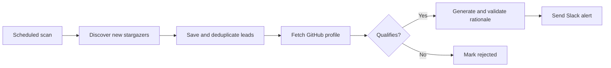

# Lead Sniper

**Turn GitHub repository interest into qualified lead alerts in Slack.**

Lead Sniper is an n8n automation that discovers new GitHub stargazers, enriches their public profiles, applies qualification rules, and uses OpenAI to draft a short personalized outreach rationale. Qualified leads arrive in an internal Slack channel for human review.

Built with **n8n Cloud · JavaScript · GitHub REST API · OpenAI · Slack · n8n Data Tables**.

## Why I built it

A repository star can be a useful signal of developer interest, but manually checking profiles and collecting context takes time. Lead Sniper brings discovery, qualification, and a suggested conversation starter into one repeatable workflow. It sends internal alerts; contacting a lead remains a human decision.

## How it works



The coordinator runs every five minutes. Only stars after the initial monitoring cutoff enter processing. A profile qualifies when it has **more than 100 followers OR more than 50 public repositories**. For qualifying profiles, the AI step uses bio and company information to generate a single sentence.

## Engineering highlights

- **Persistent progress:** scan cursors, lead stages, and retry state survive between executions.
- **Deduplication:** repository and user IDs identify each lead, preventing repeat processing across scans.
- **Concurrency control:** conditional leases and ownership checks coordinate overlapping runs.
- **Rate-limit handling:** GitHub and Slack cooldowns defer work without discarding progress.
- **Bounded AI generation:** output validation and one repair attempt constrain the generated sentence.
- **Careful delivery recovery:** ambiguous Slack responses become `delivery_unknown` for manual reconciliation rather than triggering an automatic resend.
- **Cloud-native storage:** three n8n Data Tables hold control state, leads, and sanitized error events without an external database.

## Architecture

### Main workflow


The Main Coordinator manages the processing and discovery loops. This canvas screenshot is historical: its sticky note says 240 seconds; the configured workflow timeout is 180 seconds.

### All workflow diagrams

Download the [editable five-page draw.io file](drawio/Lead-Sniper-Workflows.drawio) to explore every node and connection in diagrams.net.

| Workflow | n8n canvas PNG | Editable draw.io diagram |
| --- | --- | --- |
| Main Coordinator | [View](demo-guides/images/10-main-canvas.png) | [Main](drawio/01-main.drawio) |
| Setup and Preflight | [View](demo-guides/images/00-setup-canvas.png) | [Setup](drawio/02-setup.drawio) |
| Discover One Page | [View](demo-guides/images/20-discovery-canvas.png) | [Discovery](drawio/03-discovery.drawio) |
| Process Lead | [Part 1](demo-guides/images/30-process-lead-1.png) · [Part 2](demo-guides/images/30-process-lead-2.png) · [Part 3](demo-guides/images/30-process-lead-3.png) · [Part 4](demo-guides/images/30-process-lead-4.png) | [Process Lead](drawio/04-process-lead.drawio) |
| Record Errors | [View](demo-guides/images/40-errors-canvas.png) | [Errors](drawio/05-errors.drawio) |

The recreated diagrams preserve all 108 canvas elements and 125 connections from the selected exports. Three placeholder sub-workflows and an empty duplicate Setup export are excluded.

| Workflow | Responsibility |
| --- | --- |
| Setup and Preflight | Verify GitHub access, create tables, and initialize the monitoring cutoff. |
| Main Coordinator | Acquire a lease, resume pending leads, and coordinate discovery within a runtime budget. |
| Discover One Page | Fetch a page of stargazers, persist new leads, and advance the scan cursor. |
| Process Lead | Enrich, qualify, generate a rationale, and record Slack delivery outcomes. |
| Record Errors | Store sanitized failure details for investigation. |

The Cloud implementation uses a 150-second coordinator budget within a 180-second workflow timeout. Work that cannot safely finish in the remaining time is deferred to a later run.

## Run locally

Install Node.js and npm, then clone the project and run its build and test suite:

```bash
git clone https://github.com/Edwinzynx/lead-sniper-n8n.git
cd lead-sniper-n8n
npm ci
npm run check
```

`npm run build` regenerates workflow JSON. `npm test` runs the regression suite. These commands validate the project locally; deployment and scheduled execution happen in n8n.

## Deploy to n8n Cloud

You will need an n8n Cloud workspace with Data Tables, GitHub credentials that can read the target repository and its stargazers, a funded OpenAI API credential, and a Slack incoming webhook.

1. Import the five sanitized [Cloud workflow snapshots](submission-draft/workflows/) into one n8n project.
2. Select your GitHub and OpenAI credentials, and enter the Slack webhook privately in the Send Slack node.
3. Relink Main's child workflows and configure the shared error workflow using the imported workflow IDs.
4. Run Setup once to verify access and initialize storage.
5. Publish the error recorder, workers, and Main. Keep Setup manual.

The checked-in workflows target `Edwinzynx/hdsd-whisperFT`. To monitor another repository, update the repository URLs, validation checks, and control keys consistently before initializing monitoring. This is currently a single-repository implementation.

See the [deployment and recovery guide](CLOUD-SETUP.md) for detailed setup and operational behavior. The `scripts/import-cloud.*` helpers target an archived deployment; use the manual import steps for a new workspace.

## Validation and current status

**All 51 automated tests passed on October 22, 2026.** Coverage includes qualification boundaries, deduplication, lease ownership, rate limits, retry recovery, AI output validation, Slack delivery handling, and workflow graph integrity. External services are mocked in automated tests.

Recorded live checks verified GitHub discovery and Slack connectivity, including a clearly labeled synthetic lead alert. A complete live run from a qualifying new star through AI generation to Slack remains unverified because the configured OpenAI account lacked API credits during testing.

Polling can miss short-lived stars, and pagination can shift as users star or unstar a repository. Slack delivery is not guaranteed exactly once; ambiguous outcomes need reconciliation. Table retention and high-volume capacity planning remain operational considerations.

## Explore the project

| Path | Contents |
| --- | --- |
| [`src/`](src/) | Core processing and Cloud state-management logic. |
| [`cloud/`](cloud/) | Generated, inactive n8n Cloud templates with placeholder workflow IDs. |
| [`scripts/`](scripts/) | Workflow generators and supporting tools. |
| [`tests/`](tests/) | Automated regression tests. |
| [`demo-guides/`](demo-guides/) | Detailed workflow walkthroughs and canvas screenshots. |
| [`submission-draft/workflows/`](submission-draft/workflows/) | Sanitized Cloud deployment snapshots, retained under their original directory name. |
| [`workflows/`](workflows/) and [`sql/`](sql/) | Earlier PostgreSQL implementation; see the [alternative architecture](POSTGRES-ALTERNATIVE.md). |

For a concrete walkthrough, [follow one fictional lead through the pipeline](docs/assignment-1/04-EXAMPLE-STORY.md).
