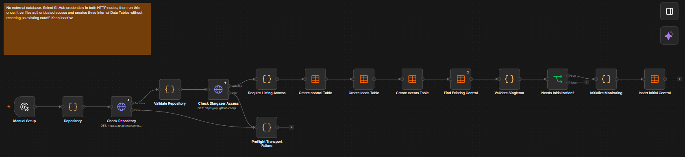
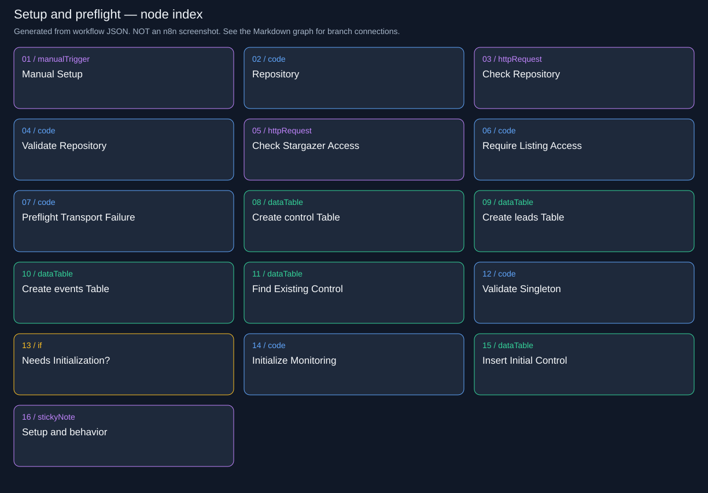
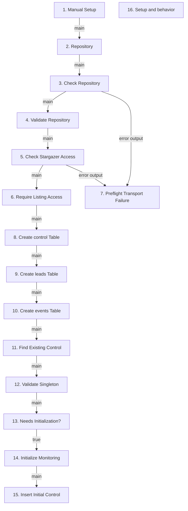

# Lead Sniper | Cloud / Setup and Authenticated Preflight

Run once before monitoring. Proves access and creates persistent state without resetting an existing baseline.

**Live canvas:** https://tryedwin.app.n8n.cloud/workflow/zr7r7pAD75jubSVE

**Canvas elements:** 16 (including sticky notes and model subnodes).

## Visual reference

Actual n8n canvas screenshots supplied by the project owner. Images are included unchanged; they show canvas layout, not proof that every branch executed successfully.

### Setup and authenticated preflight: access checks, table creation, and baseline initialization.



[Open full-resolution screenshot](images/00-setup-canvas.png)

### Supplemental node index

The following SVG and Mermaid graph are generated from the workflow export. They provide readable node names and exact branch connections; they are diagrams, not screenshots.



## How to explain this workflow

Explain this first only briefly: it is initialization, not part of every scheduled scan.

The detailed graph below shows branch labels and loops. Node numbers match the explanations. A model connection is shown as ai_languageModel; it supplies the chain, not an ordinary item stream.



## Every node explained

### 1. Manual Setup

**Node type:** `n8n-nodes-base.manualTrigger` (v1).

Starts initialization only when you deliberately run it. It is not a recurring trigger; rerunning it must preserve the original monitoring cutoff.

**Receives from:** Trigger entry or disconnected annotation; no main predecessor.

**Next paths:** main → 2. Repository


### 2. Repository

**Node type:** `n8n-nodes-base.code` (v2).

Creates the initial state envelope and selects the normal GitHub JSON media type. The next HTTP node contains the actual repository URL.

**Receives from:** 1. Manual Setup (main)

**Next paths:** main → 3. Check Repository

Runtime transformation (shared helper definitions omitted):


```javascript

return [{json:{state:{accept:'application/vnd.github+json'}}}];

```

### 3. Check Repository

**Node type:** `n8n-nodes-base.httpRequest` (v4.2).

Fetches authenticated metadata for Edwinzynx/hdsd-whisperFT. Returns body, HTTP status and headers so the next node can verify identity rather than assuming the URL is accessible.

**Receives from:** 2. Repository (main)

**Next paths:** main → 4. Validate Repository; error output → 7. Preflight Transport Failure

Request: `GET https://api.github.com/repos/Edwinzynx/hdsd-whisperFT`.

Response replaces the incoming item with HTTP response data; downstream code restores state from a named upstream node.

Node error behavior: `continueErrorOutput`. Expected provider errors and transport exceptions may take different routes.

### 4. Validate Repository

**Node type:** `n8n-nodes-base.code` (v2).

Requires HTTP 200, a repository ID, and the expected case-insensitive full name. Keeps the verified repository object and changes the Accept media type so the next request includes star timestamps. Throws on mismatch.

**Receives from:** 3. Check Repository (main)

**Next paths:** main → 5. Check Stargazer Access

Runtime transformation (shared helper definitions omitted):


```javascript

const r=$input.first().json;if(r.statusCode!==200||!r.body?.id||r.body.full_name?.toLowerCase()!=='edwinzynx/hdsd-whisperft')throw new Error('Repository preflight failed: '+r.statusCode);return [{json:{state:{repository:r.body,accept:'application/vnd.github.star+json'}}}];

```

### 5. Check Stargazer Access

**Node type:** `n8n-nodes-base.httpRequest` (v4.2).

Fetches the first timestamped page of stargazers using the GitHub credential. Repository metadata access alone does not prove permission to list the people who starred it.

**Receives from:** 4. Validate Repository (main)

**Next paths:** main → 6. Require Listing Access; error output → 7. Preflight Transport Failure

Request: `GET https://api.github.com/repos/Edwinzynx/hdsd-whisperFT/stargazers?per_page=100&page=1`.

Response replaces the incoming item with HTTP response data; downstream code restores state from a named upstream node.

Node error behavior: `continueErrorOutput`. Expected provider errors and transport exceptions may take different routes.

### 6. Require Listing Access

**Node type:** `n8n-nodes-base.code` (v2).

Requires a successful HTTP response containing an array. Stops setup before state initialization when stargazer access is unavailable.

**Receives from:** 5. Check Stargazer Access (main)

**Next paths:** main → 8. Create control Table

Runtime transformation (shared helper definitions omitted):


```javascript

const r=$input.first().json;if(r.statusCode!==200||!Array.isArray(r.body))throw new Error('Authenticated stargazer listing failed: HTTP '+r.statusCode+'; inspect GitHub permissions or rate-limit headers');return [{json:{ok:true}}];

```

### 7. Preflight Transport Failure

**Node type:** `n8n-nodes-base.code` (v2).

Receives HTTP-node transport errors and deliberately stops setup with a useful message. It prevents a network problem from being mistaken for an empty repository.

**Receives from:** 3. Check Repository (error output); 5. Check Stargazer Access (error output)

**Next paths:** No outgoing connection. This branch ends here.

Runtime transformation (shared helper definitions omitted):


```javascript

throw new Error('GitHub preflight transport failed; check the credential and connection before activating');

```

### 8. Create control Table

**Node type:** `n8n-nodes-base.dataTable` (v1.1).

Creates lead_sniper_control if absent. This table stores the repository key, version, lease owner/expiry and serialized configuration. It does not clear existing rows.

**Receives from:** 6. Require Listing Access (main)

**Next paths:** main → 9. Create leads Table

Creates table: `lead_sniper_control`; existing tables are preserved.

### 9. Create leads Table

**Node type:** `n8n-nodes-base.dataTable` (v1.1).

Creates lead_sniper_leads if absent. Visible status, stage, pending and due-time fields support efficient work selection; the data field stores the detailed profile, pitch and retry checkpoint.

**Receives from:** 8. Create control Table (main)

**Next paths:** main → 10. Create events Table

Creates table: `lead_sniper_leads`; existing tables are preserved.

### 10. Create events Table

**Node type:** `n8n-nodes-base.dataTable` (v1.1).

Creates lead_sniper_events if absent, with occurred_at and detail columns for sanitized unexpected-error metadata.

**Receives from:** 9. Create leads Table (main)

**Next paths:** main → 11. Find Existing Control

Creates table: `lead_sniper_events`; existing tables are preserved.

### 11. Find Existing Control

**Node type:** `n8n-nodes-base.dataTable` (v1.1).

Looks up this repository key, reading up to two rows so a duplicate singleton can be detected. An intentional empty output item allows initialization logic to run when there is no row.

**Receives from:** 10. Create events Table (main)

**Next paths:** main → 12. Validate Singleton

Table: `lead_sniper_control`; operation: `get`.

Filters (allConditions):

- `key` eq `Edwinzynx/hdsd-whisperFT`

Empty-result behavior: alwaysOutputData=true produces an empty item; the next normalization/check explicitly handles this case.

### 12. Validate Singleton

**Node type:** `n8n-nodes-base.code` (v2).

Rejects duplicate control rows; otherwise emits exists=true or false. This prevents two independent cursors/leases from representing the same repository.

**Receives from:** 11. Find Existing Control (main)

**Next paths:** main → 13. Needs Initialization?

Runtime transformation (shared helper definitions omitted):


```javascript

const rows=$input.all().filter(i=>i.json.id);if(rows.length>1)throw new Error('Duplicate control rows: stop and resolve before activation');return [{json:{exists:rows.length===1}}];

```

### 13. Needs Initialization?

**Node type:** `n8n-nodes-base.if` (v2.2).

Initializes only when no control row exists. The false branch ends setup without resetting any saved cutoff or cursor.

**Receives from:** 12. Validate Singleton (main)

**Next paths:** true → 14. Initialize Monitoring

Condition: `={{ $json.exists === false }}`.

### 14. Initialize Monitoring

**Node type:** `n8n-nodes-base.code` (v2).

Builds initial configuration from verified metadata. Sets monitoring_started_at to now, cursor to page 1, zero scan failures, unblocked services and model gpt-4o-mini. Emits the control row with version 0 and an expired lease.

**Receives from:** 13. Needs Initialization? (true)

**Next paths:** main → 15. Insert Initial Control

Runtime transformation (shared helper definitions omitted):


```javascript

const c=cloudInitial($('Validate Repository').first().json.state.repository);return [{json:{key:'Edwinzynx/hdsd-whisperFT',version:0,owner:'',lease_until:'1970-01-01T00:00:00.000Z',data:JSON.stringify(c)}}];

```

### 15. Insert Initial Control

**Node type:** `n8n-nodes-base.dataTable` (v1.1).

Persists the initial singleton control row. This is the durable baseline: stars at or before monitoring_started_at are excluded from lead discovery.

**Receives from:** 14. Initialize Monitoring (main)

**Next paths:** No outgoing connection. This branch ends here.

Table: `lead_sniper_control`; operation: `insert`.

Saved column mappings:

- `key` ← `={{ $json.key }}`

- `version` ← `={{ $json.version }}`

- `owner` ← `={{ $json.owner }}`

- `lease_until` ← `={{ $json.lease_until }}`

- `data` ← `={{ $json.data }}`

### 16. Setup and behavior

**Node type:** `n8n-nodes-base.stickyNote` (v1).

Canvas annotation only: no inputs, outputs, API calls or state writes. It explains setup/operation.

**Receives from:** Trigger entry or disconnected annotation; no main predecessor.

**Next paths:** No outgoing connection. This branch ends here.


## Demo accuracy notes

Only stars after setup are eligible for discovery. Qualification uses OR, not AND. A saved pitch is reused for delivery retries. Ambiguous Slack delivery is not automatically resent.

Live GitHub setup/scan and dummy Slack delivery passed. Real AI generation remains blocked by account credits. Do not describe dummy text as an LLM result.

The supplied screenshots are embedded above. Use their full-resolution links to zoom into the canvas; use the generated graph and node explanations when a connection or label is cropped or overlapped.
