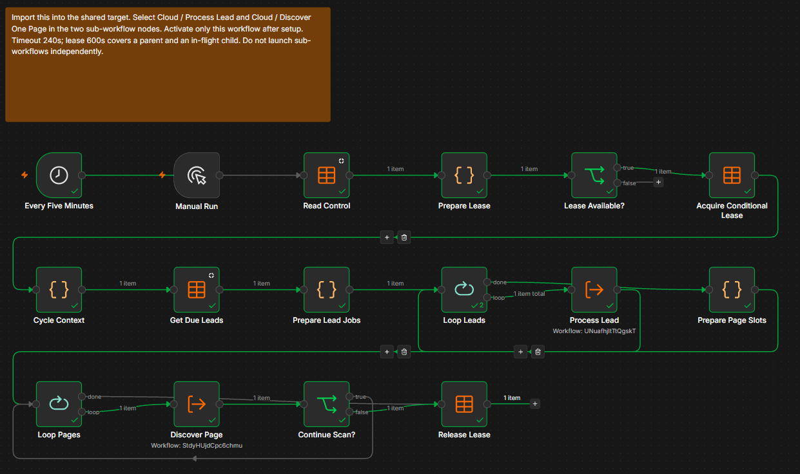
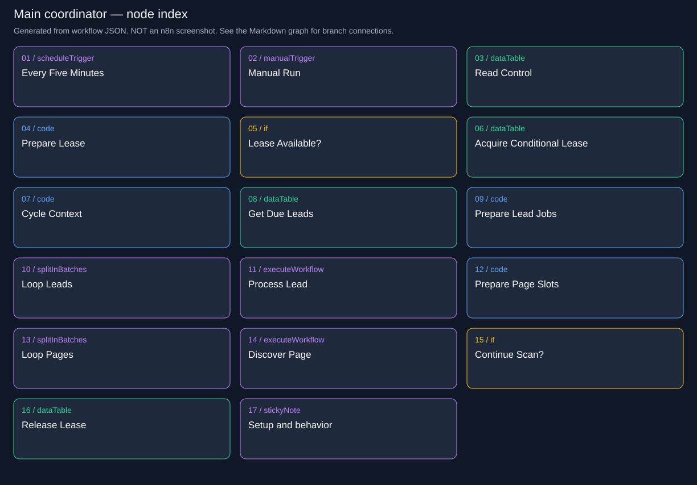
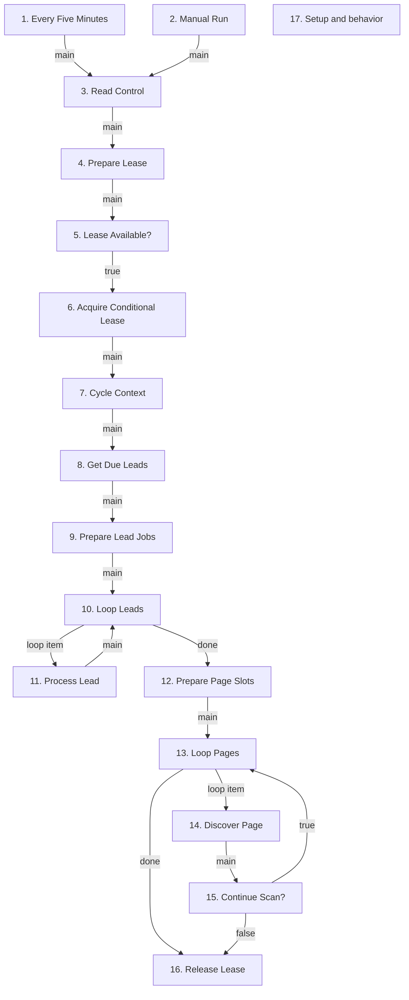

# Lead Sniper | Cloud / Main - Edwinzynx hdsd-whisperFT

Owns the schedule and lease, processes due leads, scans new pages, and releases ownership.

**Live canvas:** https://tryedwin.app.n8n.cloud/workflow/WVgWzYjdocSVykA1

**Canvas elements:** 17 (including sticky notes and model subnodes).

## Visual reference

Actual n8n canvas screenshots supplied by the project owner. Images are included unchanged; they show canvas layout, not proof that every branch executed successfully.

### Main coordinator: triggers, conditional lease, lead loop, page loop, and lease release.



[Open full-resolution screenshot](images/10-main-canvas.png)

**Demo correction:** the screenshot sticky note still says “Timeout 240s.” The configured timeout is **180 seconds**, the main cycle budget is **150 seconds**, and the lease lasts **600 seconds**. Quote the configured values in the demo. Green checks alone do not prove an AI-generated lead was delivered.

### Supplemental node index

The following SVG and Mermaid graph are generated from the workflow export. They provide readable node names and exact branch connections; they are diagrams, not screenshots.



## How to explain this workflow

Start the demo here: this canvas explains how the other workflows fit together. New stars found during discovery are normally processed in the next cycle because due leads run first.

The detailed graph below shows branch labels and loops. Node numbers match the explanations. A model connection is shown as ai_languageModel; it supplies the chain, not an ordinary item stream.



## Every node explained

### 1. Every Five Minutes

**Node type:** `n8n-nodes-base.scheduleTrigger` (v1.2).

Starts the recurring coordinator every five minutes once Main is published. The exported interval relies on the Schedule Trigger default of five minutes.

**Receives from:** Trigger entry or disconnected annotation; no main predecessor.

**Next paths:** main → 3. Read Control


### 2. Manual Run

**Node type:** `n8n-nodes-base.manualTrigger` (v1).

Starts the same coordinator path for an intentional test or immediate scan. It still passes through the lease checks, so manual execution does not bypass concurrency protection.

**Receives from:** Trigger entry or disconnected annotation; no main predecessor.

**Next paths:** main → 3. Read Control


### 3. Read Control

**Node type:** `n8n-nodes-base.dataTable` (v1.1).

Retrieves the repository control row, including the serialized configuration and current lease. Downstream code parses it and combines it with the calling context. Missing or duplicate configuration is not treated as normal work.

**Receives from:** 1. Every Five Minutes (main); 2. Manual Run (main)

**Next paths:** main → 4. Prepare Lease

Table: `lead_sniper_control`; operation: `get`.

Filters (allConditions):

- `key` eq `Edwinzynx/hdsd-whisperFT`

Empty-result behavior: alwaysOutputData=true produces an empty item; the next normalization/check explicitly handles this case.

### 4. Prepare Lease

**Node type:** `n8n-nodes-base.code` (v2).

Requires exactly one control row. Checks lease expiry, uses the current execution ID as the prospective owner, and sets a 150-second cycle deadline. This prepares an attempt; it does not yet acquire ownership.

**Receives from:** 3. Read Control (main)

**Next paths:** main → 5. Lease Available?

Runtime transformation (shared helper definitions omitted):


```javascript

const rows=$input.all().filter(i=>i.json.id);if(rows.length!==1)throw new Error('Run Setup first; exactly one control row is required');const r=rows[0].json;
return [{json:{row:r,can_start:Date.parse(r.lease_until)<=Date.now(),owner:String($execution.id),deadline:Date.now()+150000}}];

```

### 5. Lease Available?

**Node type:** `n8n-nodes-base.if` (v2.2).

Continues only if the earlier read showed an expired lease. If another run already owns the lease, this branch ends without making API calls. The conditional update still protects against races after this check.

**Receives from:** 4. Prepare Lease (main)

**Next paths:** true → 6. Acquire Conditional Lease

Condition: `={{ $json.can_start === true }}`.

### 6. Acquire Conditional Lease

**Node type:** `n8n-nodes-base.dataTable` (v1.1).

Updates only when row ID, previously read version and expired lease all still match. Increments version, stores this execution ID as owner and extends expiry by 600 seconds. A competing run that changed the row makes this update return no rows.

**Receives from:** 5. Lease Available? (true)

**Next paths:** main → 7. Cycle Context

Table: `lead_sniper_control`; operation: `update`.

Filters (allConditions):

- `id` eq `={{ $json.row.id }}`

- `version` eq `={{ $json.row.version }}`

- `lease_until` lte `={{ new Date().toISOString() }}`

Saved column mappings:

- `version` ← `={{ $json.row.version + 1 }}`

- `owner` ← `={{ $json.owner }}`

- `lease_until` ← `={{ new Date(Date.now()+600000).toISOString() }}`

### 7. Cycle Context

**Node type:** `n8n-nodes-base.code` (v2).

Verifies that the acquired row belongs to this execution, parses configuration JSON, and constructs state={control, owner, deadline, config}. This common envelope accompanies all child jobs.

**Receives from:** 6. Acquire Conditional Lease (main)

**Next paths:** main → 8. Get Due Leads

Runtime transformation (shared helper definitions omitted):


```javascript

const control=$input.first().json;const p=$('Prepare Lease').first().json;if(control.owner!==p.owner)throw new Error('Lease not acquired');return [{json:{state:{control,owner:p.owner,deadline:p.deadline,config:JSON.parse(control.data)}}}];

```

### 8. Get Due Leads

**Node type:** `n8n-nodes-base.dataTable` (v1.1).

Reads at most five pending leads whose due_at has arrived, ordered earliest first. The isTrue boolean filter avoids a string/boolean mismatch. An intentional empty result allows discovery to continue even when no lead is queued.

**Receives from:** 7. Cycle Context (main)

**Next paths:** main → 9. Prepare Lead Jobs

Table: `lead_sniper_leads`; operation: `get`.

Filters (allConditions):

- `pending` isTrue `(no value needed)`

- `due_at` lte `={{ new Date().toISOString() }}`

Empty-result behavior: alwaysOutputData=true produces an empty item; the next normalization/check explicitly handles this case.

### 9. Prepare Lead Jobs

**Node type:** `n8n-nodes-base.code` (v2).

Creates one job per queued row with lead_row_id and parsed lead JSON. If there are no rows, creates a skip=true control item solely to carry execution through the loop to discovery.

**Receives from:** 8. Get Due Leads (main)

**Next paths:** main → 10. Loop Leads

Runtime transformation (shared helper definitions omitted):


```javascript

const s=$('Cycle Context').first().json.state;const rows=$input.all().filter(i=>i.json.id);return rows.length?rows.map(i=>({json:{state:{...s,lead_row_id:i.json.id,lead:JSON.parse(i.json.data)}}})): [{json:{state:{...s,skip:true}}}];

```

### 10. Loop Leads

**Node type:** `n8n-nodes-base.splitInBatches` (v3).

Processes jobs one at a time (batch size 1). Output 1 is the per-job path; output 0 is done. After Process Lead returns, the loop advances to the next item.

**Receives from:** 9. Prepare Lead Jobs (main); 11. Process Lead (main)

**Next paths:** done → 12. Prepare Page Slots; loop item → 11. Process Lead


### 11. Process Lead

**Node type:** `n8n-nodes-base.executeWorkflow` (v1.2).

Synchronously calls the Process Lead child with the current state. Waiting for the child preserves sequential work and lets Main keep ownership of the shared lease.

**Receives from:** 10. Loop Leads (loop item)

**Next paths:** main → 10. Loop Leads

Child: `Lead Sniper | Cloud / Process Lead`; caller waits for completion. State passes through to the child trigger.

### 12. Prepare Page Slots

**Node type:** `n8n-nodes-base.code` (v2).

Creates up to 100 page opportunities from the cycle context. These are opportunities, not a promise to fetch 100 pages: time, cooldown, and end-of-pagination checks stop early.

**Receives from:** 10. Loop Leads (done)

**Next paths:** main → 13. Loop Pages

Runtime transformation (shared helper definitions omitted):


```javascript

const s=$('Cycle Context').first().json.state;return Array.from({length:100},()=>({json:{state:s}}));

```

### 13. Loop Pages

**Node type:** `n8n-nodes-base.splitInBatches` (v3).

Runs page opportunities sequentially. Per-item output calls Discover Page; done output releases the lease. Continued pages loop back only when the worker says more=true.

**Receives from:** 12. Prepare Page Slots (main); 15. Continue Scan? (true)

**Next paths:** done → 16. Release Lease; loop item → 14. Discover Page


### 14. Discover Page

**Node type:** `n8n-nodes-base.executeWorkflow` (v1.2).

Synchronously calls Discover One Page. The child reloads persisted control state so it uses the latest cursor and cooldown, rather than the initial copy carried by the page slot.

**Receives from:** 13. Loop Pages (loop item)

**Next paths:** main → 15. Continue Scan?

Child: `Lead Sniper | Cloud / Discover One Page`; caller waits for completion. State passes through to the child trigger.

### 15. Continue Scan?

**Node type:** `n8n-nodes-base.if` (v2.2).

Checks the child result state.more. True loops for another page; false releases the lease immediately, including the end-of-scan and deferred-work cases.

**Receives from:** 14. Discover Page (main)

**Next paths:** true → 13. Loop Pages; false → 16. Release Lease

Condition: `={{ $json.state.more === true }}`.

### 16. Release Lease

**Node type:** `n8n-nodes-base.dataTable` (v1.1).

Clears owner and resets lease expiry only if this execution still owns the same control row. It does not overwrite the saved cursor/configuration. A crash before this node is recovered through lease expiry.

**Receives from:** 13. Loop Pages (done); 15. Continue Scan? (false)

**Next paths:** No outgoing connection. This branch ends here.

Table: `lead_sniper_control`; operation: `update`.

Filters (allConditions):

- `id` eq `={{ $("Cycle Context").first().json.state.control.id }}`

- `owner` eq `={{ $("Cycle Context").first().json.state.owner }}`

Saved column mappings:

- `owner` ← ``

- `lease_until` ← `1970-01-01T00:00:00.000Z`

### 17. Setup and behavior

**Node type:** `n8n-nodes-base.stickyNote` (v1).

Canvas annotation only: no inputs, outputs, API calls or state writes. It explains setup/operation. This exported note still says 240s; that text is stale. The actual workflow timeout is 180 seconds, with a 150-second cycle budget.

**Receives from:** Trigger entry or disconnected annotation; no main predecessor.

**Next paths:** No outgoing connection. This branch ends here.


## Demo accuracy notes

Only stars after setup are eligible for discovery. Qualification uses OR, not AND. A saved pitch is reused for delivery retries. Ambiguous Slack delivery is not automatically resent.

Live GitHub setup/scan and dummy Slack delivery passed. Real AI generation remains blocked by account credits. Do not describe dummy text as an LLM result.

The supplied screenshots are embedded above. Use their full-resolution links to zoom into the canvas; use the generated graph and node explanations when a connection or label is cropped or overlapped.
