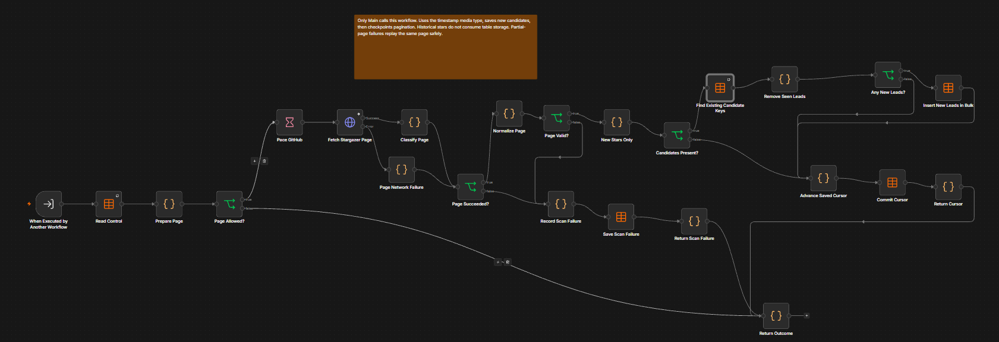
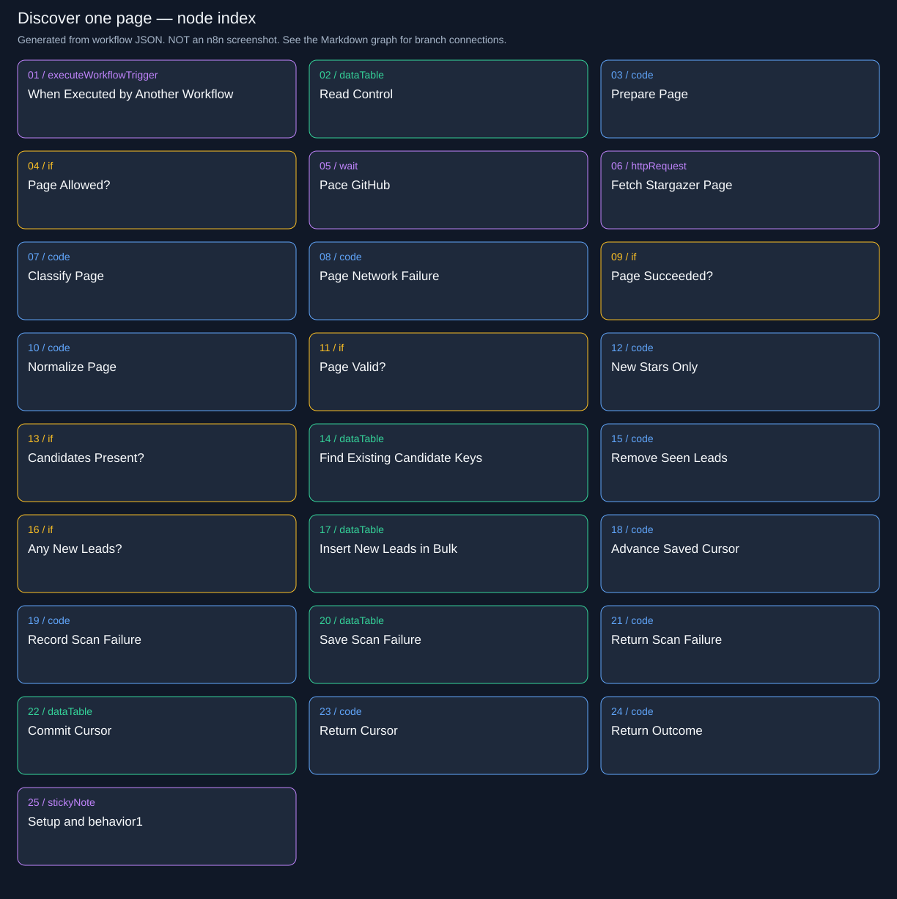
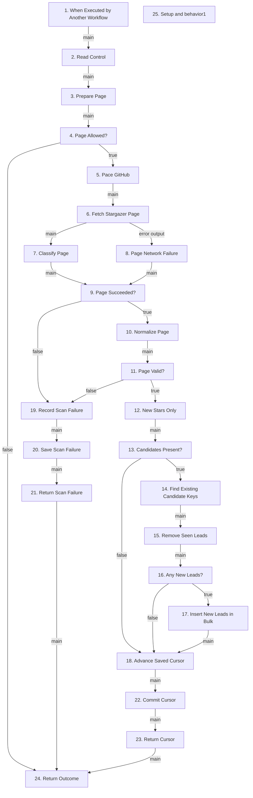

# Lead Sniper | Cloud / Discover One Page

Reads one GitHub page, removes historical/seen users, inserts new jobs, and commits a resumable cursor.

**Live canvas:** https://tryedwin.app.n8n.cloud/workflow/StdyHUjdCpc6chmu

**Canvas elements:** 25 (including sticky notes and model subnodes).

## Visual reference

Actual n8n canvas screenshots supplied by the project owner. Images are included unchanged; they show canvas layout, not proof that every branch executed successfully.

### Discovery: page request, validation, candidate deduplication, and cursor/failure checkpoints.



[Open full-resolution screenshot](images/20-discovery-canvas.png)

### Supplemental node index

The following SVG and Mermaid graph are generated from the workflow export. They provide readable node names and exact branch connections; they are diagrams, not screenshots.



## How to explain this workflow

Emphasize that successful storage must happen before cursor advancement. The discovery workflow does not fetch full profiles or send messages.

The detailed graph below shows branch labels and loops. Node numbers match the explanations. A model connection is shown as ai_languageModel; it supplies the chain, not an ordinary item stream.



## Every node explained

### 1. When Executed by Another Workflow

**Node type:** `n8n-nodes-base.executeWorkflowTrigger` (v1.1).

Accepts all caller input unchanged. Main supplies a state envelope. This is a worker entry point, not a separate polling schedule or public webhook.

**Receives from:** Trigger entry or disconnected annotation; no main predecessor.

**Next paths:** main → 2. Read Control


### 2. Read Control

**Node type:** `n8n-nodes-base.dataTable` (v1.1).

Retrieves the repository control row, including the serialized configuration and current lease. Downstream code parses it and combines it with the calling context. Missing or duplicate configuration is not treated as normal work.

**Receives from:** 1. When Executed by Another Workflow (main)

**Next paths:** main → 3. Prepare Page

Table: `lead_sniper_control`; operation: `get`.

Filters (allConditions):

- `key` eq `Edwinzynx/hdsd-whisperFT`

Empty-result behavior: alwaysOutputData=true produces an empty item; the next normalization/check explicitly handles this case.

### 3. Prepare Page

**Node type:** `n8n-nodes-base.code` (v2).

Reloads config from the current control row, sets timestamped-star media type, and requires lease ownership, at least 40 seconds remaining, no GitHub pause and an expired GitHub cooldown. Missing control throws.

**Receives from:** 2. Read Control (main)

**Next paths:** main → 4. Page Allowed?

Runtime transformation (shared helper definitions omitted):


```javascript

const initial=$('When Executed by Another Workflow').first().json.state;const control=$input.first().json;if(!control.id)throw new Error('Missing control');const config=JSON.parse(control.data);const s={...initial,control,config,accept:'application/vnd.github.star+json'};
s.allowed=cloudCanWork(s,40)&&!config.github_paused&&Date.parse(config.github_blocked_until)<=Date.now();return [{json:{state:s}}];

```

### 4. Page Allowed?

**Node type:** `n8n-nodes-base.if` (v2.2).

Routes allowed work to pacing and HTTP. Otherwise returns a compact outcome without advancing the cursor or calling GitHub.

**Receives from:** 3. Prepare Page (main)

**Next paths:** true → 5. Pace GitHub; false → 24. Return Outcome

Condition: `={{ $json.state.allowed === true }}`.

### 5. Pace GitHub

**Node type:** `n8n-nodes-base.wait` (v1.1).

Waits one second before the page request, reducing burst pressure. Retry cooldowns are separate persistent timestamps, not long sleeping executions.

**Receives from:** 4. Page Allowed? (true)

**Next paths:** main → 6. Fetch Stargazer Page


### 6. Fetch Stargazer Page

**Node type:** `n8n-nodes-base.httpRequest` (v4.2).

GETs state.config.next_url with GitHub authentication and timestamped-star media type. Keeps status/body/headers for explicit classification. Uses a 30-second timeout and disables redirects.

**Receives from:** 5. Pace GitHub (main)

**Next paths:** main → 7. Classify Page; error output → 8. Page Network Failure

Request: `GET ={{ $json.state.config.next_url }}`.

Response replaces the incoming item with HTTP response data; downstream code restores state from a named upstream node.

Node error behavior: `continueErrorOutput`. Expected provider errors and transport exceptions may take different routes.

### 7. Classify Page

**Node type:** `n8n-nodes-base.code` (v2).

Maps the HTTP response into success, retry, or failed with a reason and optional retry_at. Reads Retry-After/rate-reset headers; distinguishes authentication, access and transient errors.

**Receives from:** 6. Fetch Stargazer Page (main)

**Next paths:** main → 9. Page Succeeded?

Runtime transformation (shared helper definitions omitted):


```javascript

const s=$('Prepare Page').first().json.state;const r=classifyGitHub($input.first().json,s.config.scan_failures);return [{json:{state:{...s,result:r}}}];

```

### 8. Page Network Failure

**Node type:** `n8n-nodes-base.code` (v2).

Converts a timeout/transport exception into the same retry result shape used for HTTP failures. Reattaches the original page context because an HTTP error does not preserve it automatically.

**Receives from:** 6. Fetch Stargazer Page (error output)

**Next paths:** main → 9. Page Succeeded?

Runtime transformation (shared helper definitions omitted):


```javascript

const s=$('Prepare Page').first().json.state;return [{json:{state:{...s,result:classifyGitHub({},s.config.scan_failures)}}}];

```

### 9. Page Succeeded?

**Node type:** `n8n-nodes-base.if` (v2.2).

Only successful responses reach normalization. Retry and permanent failures go to Record Scan Failure, leaving the current cursor intact.

**Receives from:** 7. Classify Page (main); 8. Page Network Failure (main)

**Next paths:** true → 10. Normalize Page; false → 19. Record Scan Failure

Condition: `={{ $json.state.result.outcome === "success" }}`.

### 10. Normalize Page

**Node type:** `n8n-nodes-base.code` (v2).

Validates every entry has a numeric user ID, valid login and parseable star time. Normalizes event fields and validates any next-page link has the same GitHub origin/path with forward pagination. Invalid data becomes an explicit failed result.

**Receives from:** 9. Page Succeeded? (true)

**Next paths:** main → 11. Page Valid?

Runtime transformation (shared helper definitions omitted):


```javascript

const s=$input.first().json.state;try{const p=normalizePage(s.result.body,s.result.headers,s.config.next_url);return [{json:{state:{...s,page:p,valid:true}}}];}catch{return [{json:{state:{...s,valid:false,result:{outcome:'failed',reason:'invalid_stargazer_page'}}}}];}

```

### 11. Page Valid?

**Node type:** `n8n-nodes-base.if` (v2.2).

Routes validated pages into new-star filtering. Malformed entries or unsafe pagination follow the scan-failure path rather than silently advancing.

**Receives from:** 10. Normalize Page (main)

**Next paths:** true → 12. New Stars Only; false → 19. Record Scan Failure

Condition: `={{ $json.state.valid === true }}`.

### 12. New Stars Only

**Node type:** `n8n-nodes-base.code` (v2).

Filters star times strictly after the stored cutoff and deduplicates user IDs within the page. Emits one state item holding a candidates array; it does not yet create database rows.

**Receives from:** 11. Page Valid? (true)

**Next paths:** main → 13. Candidates Present?

Runtime transformation (shared helper definitions omitted):


```javascript

const s=$input.first().json.state;const candidates=[...new Map(s.page.events.filter(e=>Date.parse(e.starred_at)>Date.parse(s.config.monitoring_started_at)).map(e=>[e.user_id,e])).values()];return [{json:{state:{...s,candidates}}}];

```

### 13. Candidates Present?

**Node type:** `n8n-nodes-base.if` (v2.2).

Runs the key lookup only when candidates exist. No candidates still advances the page cursor because the page was successfully examined.

**Receives from:** 12. New Stars Only (main)

**Next paths:** true → 14. Find Existing Candidate Keys; false → 18. Advance Saved Cursor

Condition: `={{ $json.state.candidates.length > 0 }}`.

### 14. Find Existing Candidate Keys

**Node type:** `n8n-nodes-base.dataTable` (v1.1).

Uses up to 100 explicit OR conditions to find saved repository-ID/user-ID keys in one lookup. Unused slots use __unused__, which cannot match the numeric lead-key format. Explicit condition objects avoid the dynamic-array import corruption found during setup.

**Receives from:** 13. Candidates Present? (true)

**Next paths:** main → 15. Remove Seen Leads

Table: `lead_sniper_leads`; operation: `get`.

Lookup: 100 OR key conditions, each mapping a candidate index to `repo_id:user_id`, or `__unused__` for absent candidates.

Empty-result behavior: alwaysOutputData=true produces an empty item; the next normalization/check explicitly handles this case.

### 15. Remove Seen Leads

**Node type:** `n8n-nodes-base.code` (v2).

Builds a set of existing keys and removes already-recorded candidates. Duplicate stored keys throw for inspection. Each new candidate becomes a queued/profile lead with zero attempts; if none remain, has_new=false keeps the cursor path alive.

**Receives from:** 14. Find Existing Candidate Keys (main)

**Next paths:** main → 16. Any New Leads?

Runtime transformation (shared helper definitions omitted):


```javascript

const s=$('New Stars Only').first().json.state;const rows=$input.all().filter(i=>i.json.id);const seen=new Set(rows.map(i=>i.json.key));if(seen.size!==rows.length)throw new Error('Duplicate lead keys; stop and inspect table writers');const fresh=s.candidates.filter(e=>!seen.has(s.config.repo_id+':'+e.user_id));return fresh.length?fresh.map(e=>({json:{state:{...s,lead:cloudNewLead(e,s.config),has_new:true}}})): [{json:{state:{...s,has_new:false}}}];

```

### 16. Any New Leads?

**Node type:** `n8n-nodes-base.if` (v2.2).

Inserts only genuinely unseen lead records. If all candidates were already saved, skips insertion and advances the cursor, supporting replay without resetting leads.

**Receives from:** 15. Remove Seen Leads (main)

**Next paths:** true → 17. Insert New Leads in Bulk; false → 18. Advance Saved Cursor

Condition: `={{ $json.state.has_new === true }}`.

### 17. Insert New Leads in Bulk

**Node type:** `n8n-nodes-base.dataTable` (v1.1).

Persists new keys plus queued status, profile stage, pending=true, due_at and serialized lead data. Bulk mode avoids one write round trip per star. Cursor commit happens downstream, after this succeeds.

**Receives from:** 16. Any New Leads? (true)

**Next paths:** main → 18. Advance Saved Cursor

Table: `lead_sniper_leads`; operation: `insert`.

Saved column mappings:

- `key` ← `={{ $json.state.lead.key }}`

- `status` ← `queued`

- `stage` ← `profile`

- `pending` ← `True`

- `due_at` ← `={{ $json.state.lead.due_at }}`

- `data` ← `={{ JSON.stringify($json.state.lead) }}`

### 18. Advance Saved Cursor

**Node type:** `n8n-nodes-base.code` (v2).

Prepares updated config: next page if present, otherwise page 1 for the next scan; resets failure counters and records last_complete_scan at end. Sets more according to pagination. This node prepares data but does not persist it.

**Receives from:** 13. Candidates Present? (false); 16. Any New Leads? (false); 17. Insert New Leads in Bulk (main)

**Next paths:** main → 22. Commit Cursor

Runtime transformation (shared helper definitions omitted):


```javascript

const s=$('Normalize Page').first().json.state;const c={...s.config,next_url:s.page.next_url||"https://api.github.com/repos/Edwinzynx/hdsd-whisperFT/stargazers?per_page=100&page=1",scan_pages:s.page.next_url?s.config.scan_pages+1:0,scan_failures:0,last_error:null};if(!s.page.next_url)c.last_complete_scan=new Date().toISOString();return [{json:{state:{...s,config:c,more:!!s.page.next_url}}}];

```

### 19. Record Scan Failure

**Node type:** `n8n-nodes-base.code` (v2).

Records reason and retry time, increases scan failures unless the classifier says not to count the attempt, and pauses after permanent failure or five counted failures. Forces more=false to stop this cycle.

**Receives from:** 9. Page Succeeded? (false); 11. Page Valid? (false)

**Next paths:** main → 20. Save Scan Failure

Runtime transformation (shared helper definitions omitted):


```javascript

const s=$input.first().json.state;const r=s.result;const failures=s.config.scan_failures+(r.count_attempt===false?0:1);const config={...s.config,scan_failures:failures,last_error:r.reason,github_paused:r.outcome==='failed'||failures>=5,github_blocked_until:r.retry_at||s.config.github_blocked_until};return [{json:{state:{...s,config,more:false}}}];

```

### 20. Save Scan Failure

**Node type:** `n8n-nodes-base.dataTable` (v1.1).

Saves failure/cooldown configuration only while this owner still holds the control row. Preserves the failed page cursor for a later attempt.

**Receives from:** 19. Record Scan Failure (main)

**Next paths:** main → 21. Return Scan Failure

Table: `lead_sniper_control`; operation: `update`.

Filters (allConditions):

- `id` eq `={{ $json.state.control.id }}`

- `owner` eq `={{ $json.state.owner }}`

Saved column mappings:

- `data` ← `={{ JSON.stringify($json.state.config) }}`

### 21. Return Scan Failure

**Node type:** `n8n-nodes-base.code` (v2).

Restores the prepared failure state after the table update replaced the item with its database response. This is a data-mapping bridge, not a second failure calculation.

**Receives from:** 20. Save Scan Failure (main)

**Next paths:** main → 24. Return Outcome

Runtime transformation (shared helper definitions omitted):


```javascript

return [{json:{state:$('Record Scan Failure').first().json.state}}];

```

### 22. Commit Cursor

**Node type:** `n8n-nodes-base.dataTable` (v1.1).

Conditionally persists the prepared next cursor while this run owns the control row. Since inserts precede this commit, a crash can replay saved keys safely instead of losing unseen users.

**Receives from:** 18. Advance Saved Cursor (main)

**Next paths:** main → 23. Return Cursor

Table: `lead_sniper_control`; operation: `update`.

Filters (allConditions):

- `id` eq `={{ $json.state.control.id }}`

- `owner` eq `={{ $json.state.owner }}`

Saved column mappings:

- `data` ← `={{ JSON.stringify($json.state.config) }}`

### 23. Return Cursor

**Node type:** `n8n-nodes-base.code` (v2).

Restores the cursor state from Advance Saved Cursor after the database update. This retains the more flag needed by Main.

**Receives from:** 22. Commit Cursor (main)

**Next paths:** main → 24. Return Outcome

Runtime transformation (shared helper definitions omitted):


```javascript

return [{json:{state:$('Advance Saved Cursor').first().json.state}}];

```

### 24. Return Outcome

**Node type:** `n8n-nodes-base.code` (v2).

Returns only state.more, done=true, and a status, rather than the full internal profile/configuration. Main uses the more flag for page loops; lead status is informational.

**Receives from:** 4. Page Allowed? (false); 21. Return Scan Failure (main); 23. Return Cursor (main)

**Next paths:** No outgoing connection. This branch ends here.

Runtime transformation (shared helper definitions omitted):


```javascript

const s=$input.first().json.state||{};return [{json:{state:{more:s.more===true,done:true,status:s.lead?.status||s.status||'idle'}}}];

```

### 25. Setup and behavior1

**Node type:** `n8n-nodes-base.stickyNote` (v1).

Canvas annotation only: no inputs, outputs, API calls or state writes. It explains setup/operation.

**Receives from:** Trigger entry or disconnected annotation; no main predecessor.

**Next paths:** No outgoing connection. This branch ends here.


## Demo accuracy notes

Only stars after setup are eligible for discovery. Qualification uses OR, not AND. A saved pitch is reused for delivery retries. Ambiguous Slack delivery is not automatically resent.

Live GitHub setup/scan and dummy Slack delivery passed. Real AI generation remains blocked by account credits. Do not describe dummy text as an LLM result.

The supplied screenshots are embedded above. Use their full-resolution links to zoom into the canvas; use the generated graph and node explanations when a connection or label is cropped or overlapped.
