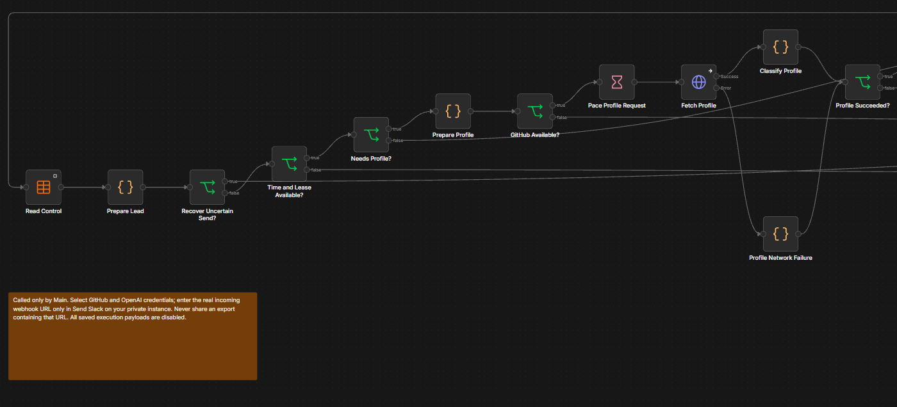
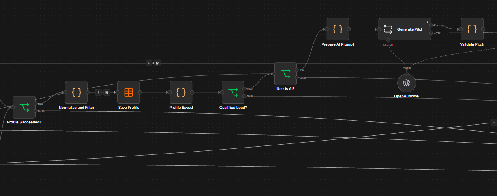
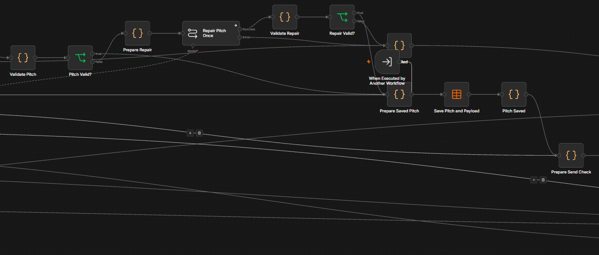
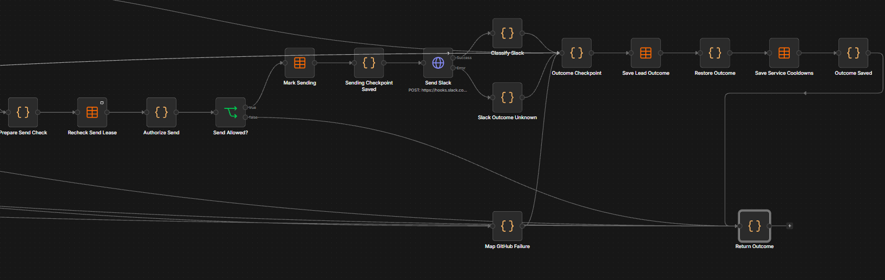
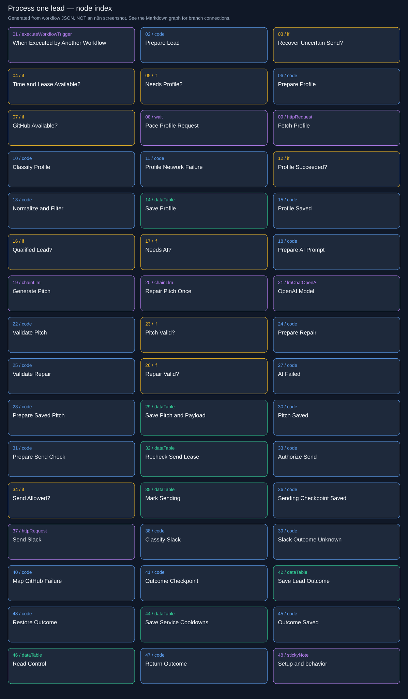
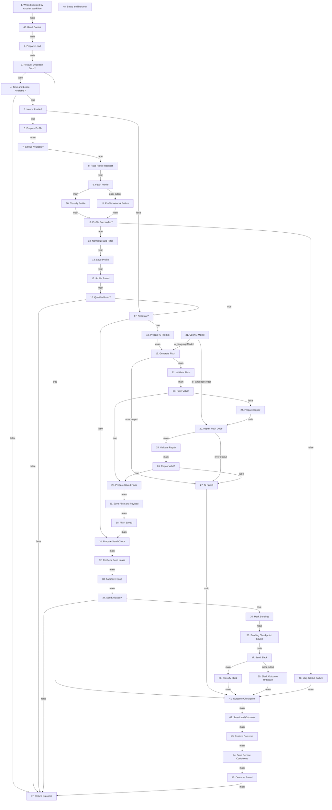

# Lead Sniper | Cloud / Process Lead

Resumes a single lead through profile validation, qualification, AI, Slack, and durable outcomes.

**Live canvas:** https://tryedwin.app.n8n.cloud/workflow/UNuafhjltTtQgskT

**Canvas elements:** 48 (including sticky notes and model subnodes).

## Visual reference

Actual n8n canvas screenshots supplied by the project owner. Images are included unchanged; they show canvas layout, not proof that every branch executed successfully.

### Part 1 — Control/lease checks, interrupted-send recovery, and profile request.



[Open full-resolution screenshot](images/30-process-lead-1.png)

### Part 2 — Profile validation, qualification, profile persistence, and initial LLM generation.



[Open full-resolution screenshot](images/30-process-lead-2.png)

### Part 3 — Pitch validation/repair and saving the pitch and Slack payload.



[Open full-resolution screenshot](images/30-process-lead-3.png)

### Part 4 — Send authorization, sending checkpoint, Slack response handling, and durable outcomes.



[Open full-resolution screenshot](images/30-process-lead-4.png)

**How to read these four views:** follow Parts 1–4 above. They overlap and crop some connecting lines. In Part 3, **When Executed by Another Workflow** is positioned on top of **AI Failed**, partially hiding its label. Its visual position does not mean it runs after pitch repair: logically the trigger starts at **Read Control**, as shown in the connection graph below. Every node, including the obscured one, is explained in this guide.

### Supplemental node index

The following SVG and Mermaid graph are generated from the workflow export. They provide readable node names and exact branch connections; they are diagrams, not screenshots.



## How to explain this workflow

Explain in four sections: profile, AI, delivery, recovery. The real model is configured but unfunded; the demonstrated dummy text did not come from this production AI path.

The detailed graph below shows branch labels and loops. Node numbers match the explanations. A model connection is shown as ai_languageModel; it supplies the chain, not an ordinary item stream.



## Every node explained

### 1. When Executed by Another Workflow

**Node type:** `n8n-nodes-base.executeWorkflowTrigger` (v1.1).

Accepts all caller input unchanged. Main supplies a state envelope. This is a worker entry point, not a separate polling schedule or public webhook.

**Receives from:** Trigger entry or disconnected annotation; no main predecessor.

**Next paths:** main → 46. Read Control


### 2. Prepare Lead

**Node type:** `n8n-nodes-base.code` (v2).

Combines caller job with fresh control/config. Requires no skip flag and at least 115 seconds remaining under the lease. A previously interrupted sending lead becomes delivery_unknown when ownership is valid, so it will not be blindly resent.

**Receives from:** 46. Read Control (main)

**Next paths:** main → 3. Recover Uncertain Send?

Runtime transformation (shared helper definitions omitted):


```javascript

const s=$('When Executed by Another Workflow').first().json.state;const control=$input.first().json;const config=JSON.parse(control.data);const state={...s,control,config};state.allowed=!s.skip&&cloudCanWork(state,115);if(s.lead?.status==='sending'&&cloudCanWork(state)){state.lead=cloudLeadOutcome(s.lead,{outcome:'unknown',reason:'previous_execution_interrupted_during_send'});state.recover_unknown=true;}return [{json:{state}}];

```

### 3. Recover Uncertain Send?

**Node type:** `n8n-nodes-base.if` (v2.2).

Routes recovered interrupted sends directly to durable outcome saving. Otherwise continues to the normal time/lease gate.

**Receives from:** 2. Prepare Lead (main)

**Next paths:** true → 41. Outcome Checkpoint; false → 4. Time and Lease Available?

Condition: `={{ $json.state.recover_unknown === true }}`.

### 4. Time and Lease Available?

**Node type:** `n8n-nodes-base.if` (v2.2).

Allows processing only while ownership and the minimum runtime budget hold. If false, returns without changing the queued job so a later cycle can pick it up.

**Receives from:** 3. Recover Uncertain Send? (false)

**Next paths:** true → 5. Needs Profile?; false → 47. Return Outcome

Condition: `={{ $json.state.allowed === true }}`.

### 5. Needs Profile?

**Node type:** `n8n-nodes-base.if` (v2.2).

Checks whether the saved stage is profile. New work fetches GitHub; AI/delivery retries skip the already-completed profile step.

**Receives from:** 4. Time and Lease Available? (true)

**Next paths:** true → 6. Prepare Profile; false → 17. Needs AI?

Condition: `={{ $json.state.lead.stage === "profile" }}`.

### 6. Prepare Profile

**Node type:** `n8n-nodes-base.code` (v2).

Checks GitHub pause/cooldown and selects normal profile JSON media type. Keeps the lead state while preparing request_allowed.

**Receives from:** 5. Needs Profile? (true)

**Next paths:** main → 7. GitHub Available?

Runtime transformation (shared helper definitions omitted):


```javascript

const s=$input.first().json.state;s.request_allowed=!s.config.github_paused&&Date.parse(s.config.github_blocked_until)<=Date.now();return [{json:{state:{...s,accept:'application/vnd.github+json'}}}];

```

### 7. GitHub Available?

**Node type:** `n8n-nodes-base.if` (v2.2).

Runs profile fetch only when GitHub is not paused or cooling down. Otherwise returns with the lead unchanged.

**Receives from:** 6. Prepare Profile (main)

**Next paths:** true → 8. Pace Profile Request; false → 47. Return Outcome

Condition: `={{ $json.state.request_allowed === true }}`.

### 8. Pace Profile Request

**Node type:** `n8n-nodes-base.wait` (v1.1).

Waits one second before requesting an individual profile to reduce burst traffic.

**Receives from:** 7. GitHub Available? (true)

**Next paths:** main → 9. Fetch Profile


### 9. Fetch Profile

**Node type:** `n8n-nodes-base.httpRequest` (v4.2).

Requests /users/{login} with the configured GitHub credential, full JSON response and 30-second timeout. Profile identity is checked against the star user ID after the response arrives.

**Receives from:** 8. Pace Profile Request (main)

**Next paths:** main → 10. Classify Profile; error output → 11. Profile Network Failure

Request: `GET ={{ "https://api.github.com/users/"+encodeURIComponent($json.state.lead.login) }}`.

Response replaces the incoming item with HTTP response data; downstream code restores state from a named upstream node.

Node error behavior: `continueErrorOutput`. Expected provider errors and transport exceptions may take different routes.

### 10. Classify Profile

**Node type:** `n8n-nodes-base.code` (v2).

Classifies success, retry or permanent failure using the profile attempt count and GitHub response headers. Reattaches the pre-request state.

**Receives from:** 9. Fetch Profile (main)

**Next paths:** main → 12. Profile Succeeded?

Runtime transformation (shared helper definitions omitted):


```javascript

const s=$('Prepare Profile').first().json.state;return [{json:{state:{...s,result:classifyGitHub($input.first().json,s.lead.attempts.profile)}}}];

```

### 11. Profile Network Failure

**Node type:** `n8n-nodes-base.code` (v2).

Produces a transient retry result for profile timeouts or network exceptions, then joins the normal profile response gate.

**Receives from:** 9. Fetch Profile (error output)

**Next paths:** main → 12. Profile Succeeded?

Runtime transformation (shared helper definitions omitted):


```javascript

const s=$('Prepare Profile').first().json.state;return [{json:{state:{...s,result:classifyGitHub({},s.lead.attempts.profile)}}}];

```

### 12. Profile Succeeded?

**Node type:** `n8n-nodes-base.if` (v2.2).

Successful HTTP responses go to identity/qualification checks. Other results go to Map GitHub Failure so retry state and shared cooldown can be saved.

**Receives from:** 10. Classify Profile (main); 11. Profile Network Failure (main)

**Next paths:** true → 13. Normalize and Filter; false → 40. Map GitHub Failure

Condition: `={{ $json.state.result.outcome === "success" }}`.

### 13. Normalize and Filter

**Node type:** `n8n-nodes-base.code` (v2).

Validates profile ID, username and nonnegative integer counts. Normalizes name/bio/company. Qualifies strictly on followers >100 OR public_repos >50: qualified becomes processing/ai/pending; unqualified becomes rejected/pending=false. Malformed identity/counts become failed.

**Receives from:** 12. Profile Succeeded? (true)

**Next paths:** main → 14. Save Profile

Runtime transformation (shared helper definitions omitted):


```javascript

const s=$input.first().json.state;let lead={...s.lead};try{lead.profile=normalizeProfile(s.result.body,lead.user_id);const d=qualification(lead.profile);lead.reasons=d.reasons;lead.stage=d.qualified?'ai':'profile';lead.status=d.qualified?'processing':'rejected';lead.pending=d.qualified;lead.login=lead.profile.username;}catch(e){lead=cloudLeadOutcome(lead,{outcome:'failed',reason:e.message});}return [{json:{state:{...s,lead}}}];

```

### 14. Save Profile

**Node type:** `n8n-nodes-base.dataTable` (v1.1).

Persists the normalized profile and qualification outcome before spending LLM credits. Writes visible lead fields and serialized JSON by lead_row_id.

**Receives from:** 13. Normalize and Filter (main)

**Next paths:** main → 15. Profile Saved

Table: `lead_sniper_leads`; operation: `update`.

Filters (allConditions):

- `id` eq `={{ $json.state.lead_row_id }}`

Saved column mappings:

- `key` ← `={{ $json.state.lead.key }}`

- `status` ← `={{ $json.state.lead.status }}`

- `stage` ← `={{ $json.state.lead.stage }}`

- `pending` ← `={{ $json.state.lead.pending }}`

- `due_at` ← `={{ $json.state.lead.due_at }}`

- `data` ← `={{ JSON.stringify($json.state.lead) }}`

### 15. Profile Saved

**Node type:** `n8n-nodes-base.code` (v2).

Restores state from Normalize and Filter after the table update. Later nodes need the prepared state envelope, not the update response.

**Receives from:** 14. Save Profile (main)

**Next paths:** main → 16. Qualified Lead?

Runtime transformation (shared helper definitions omitted):


```javascript

return [{json:{state:$('Normalize and Filter').first().json.state}}];

```

### 16. Qualified Lead?

**Node type:** `n8n-nodes-base.if` (v2.2).

Uses the saved pending flag to continue qualified work. Rejected or validation-failed profiles return without invoking AI or Slack.

**Receives from:** 15. Profile Saved (main)

**Next paths:** true → 17. Needs AI?; false → 47. Return Outcome

Condition: `={{ $json.state.lead.pending === true }}`.

### 17. Needs AI?

**Node type:** `n8n-nodes-base.if` (v2.2).

Runs AI only when stage is ai. A delivery retry bypasses AI and reuses the saved pitch/payload.

**Receives from:** 5. Needs Profile? (false); 16. Qualified Lead? (true)

**Next paths:** true → 18. Prepare AI Prompt; false → 31. Prepare Send Check

Condition: `={{ $json.state.lead.stage === "ai" }}`.

### 18. Prepare AI Prompt

**Node type:** `n8n-nodes-base.code` (v2).

Builds a prompt from bio/company and optional product context. Requests one plain-text sentence, treats profile text as untrusted, forbids invented claims, and defines a restrained response for missing context.

**Receives from:** 17. Needs AI? (true)

**Next paths:** main → 19. Generate Pitch

Runtime transformation (shared helper definitions omitted):


```javascript

const s=$input.first().json.state;return [{json:{state:{...s,prompt:pitchPrompt(s.lead.profile,s.config.product_context)}}}];

```

### 19. Generate Pitch

**Node type:** `@n8n/n8n-nodes-langchain.chainLlm` (v1.7).

Basic LLM Chain submits state.prompt to the attached OpenAI model. Returns text, which must pass validation before it can be sent. Model/chain errors go to AI Failed.

**Receives from:** 18. Prepare AI Prompt (main); 21. OpenAI Model (ai_languageModel)

**Next paths:** main → 22. Validate Pitch; error output → 27. AI Failed

Prompt mapping: `={{ $json.state.prompt }}`; output is normally `{text: "generated sentence"}`.

Node error behavior: `continueErrorOutput`. Expected provider errors and transport exceptions may take different routes.

### 20. Repair Pitch Once

**Node type:** `@n8n/n8n-nodes-langchain.chainLlm` (v1.7).

Makes one fresh generation attempt using the repair prompt. It is a bounded format repair, not an unlimited loop; another invalid result goes to AI Failed.

**Receives from:** 21. OpenAI Model (ai_languageModel); 24. Prepare Repair (main)

**Next paths:** main → 25. Validate Repair; error output → 27. AI Failed

Prompt mapping: `={{ $json.state.prompt }}`; output is normally `{text: "generated sentence"}`.

Node error behavior: `continueErrorOutput`. Expected provider errors and transport exceptions may take different routes.

### 21. OpenAI Model

**Node type:** `@n8n/n8n-nodes-langchain.lmChatOpenAi` (v1.2).

Shared model subnode for initial generation and repair. Resolves the model from Prepare AI Prompt configuration (gpt-4o-mini), uses temperature 0.2, maxTokens 160, timeout 20 seconds and maxRetries 0. This subnode supplies the chain and is not a main data-flow step. Live use is blocked by missing API credits.

**Receives from:** Trigger entry or disconnected annotation; no main predecessor.

**Next paths:** ai_languageModel → 19. Generate Pitch; ai_languageModel → 20. Repair Pitch Once

Model: `={{ $("Prepare AI Prompt").first().json.state.config.llm_model }}`; settings: `{"maxTokens": 160, "temperature": 0.2, "timeout": 20000, "maxRetries": 0}`.

### 22. Validate Pitch

**Node type:** `n8n-nodes-base.code` (v2).

Takes chain text and restores original prompt state. Checks nonempty plain text, one sentence, terminal punctuation, no newlines/links, at most 60 words and 800 characters. It validates format, not factual truth.

**Receives from:** 19. Generate Pitch (main)

**Next paths:** main → 23. Pitch Valid?

Runtime transformation (shared helper definitions omitted):


```javascript

const s=$('Prepare AI Prompt').first().json.state;const validation=validatePitch($input.first().json.text);return [{json:{state:{...s,validation,pitch:validation.pitch}}}];

```

### 23. Pitch Valid?

**Node type:** `n8n-nodes-base.if` (v2.2).

Accepted text moves to persistence. Invalid formatting goes through exactly one repair attempt.

**Receives from:** 22. Validate Pitch (main)

**Next paths:** true → 28. Prepare Saved Pitch; false → 24. Prepare Repair

Condition: `={{ $json.state.validation.valid === true }}`.

### 24. Prepare Repair

**Node type:** `n8n-nodes-base.code` (v2).

Regenerates the same profile-based prompt with the validation reason. Does not treat the invalid output as trusted instructions.

**Receives from:** 23. Pitch Valid? (false)

**Next paths:** main → 20. Repair Pitch Once

Runtime transformation (shared helper definitions omitted):


```javascript

const s=$input.first().json.state;return [{json:{state:{...s,prompt:pitchPrompt(s.lead.profile,s.config.product_context,s.validation.reason)}}}];

```

### 25. Validate Repair

**Node type:** `n8n-nodes-base.code` (v2).

Applies the same one-sentence/plain-text limits to repair output and restores the repair context.

**Receives from:** 20. Repair Pitch Once (main)

**Next paths:** main → 26. Repair Valid?

Runtime transformation (shared helper definitions omitted):


```javascript

const s=$('Prepare Repair').first().json.state;const validation=validatePitch($input.first().json.text);return [{json:{state:{...s,validation,pitch:validation.pitch}}}];

```

### 26. Repair Valid?

**Node type:** `n8n-nodes-base.if` (v2.2).

Valid repair proceeds to save. A second invalid result follows AI Failed rather than another repair loop.

**Receives from:** 25. Validate Repair (main)

**Next paths:** true → 28. Prepare Saved Pitch; false → 27. AI Failed

Condition: `={{ $json.state.validation.valid === true }}`.

### 27. AI Failed

**Node type:** `n8n-nodes-base.code` (v2).

Marks the AI stage for a delayed retry and increments its failure count; the fifth counted failure becomes failed/pending=false. Reuses the saved profile. The current no-credit error follows this path.

**Receives from:** 19. Generate Pitch (error output); 20. Repair Pitch Once (error output); 26. Repair Valid? (false)

**Next paths:** main → 41. Outcome Checkpoint

Runtime transformation (shared helper definitions omitted):


```javascript

const s=$('Prepare AI Prompt').first().json.state;return [{json:{state:{...s,lead:cloudLeadOutcome(s.lead,{outcome:'retry',reason:'ai_generation_or_validation_failed'})}}}];

```

### 28. Prepare Saved Pitch

**Node type:** `n8n-nodes-base.code` (v2).

Copies validated pitch into lead, advances stage to delivery, records model/prompt version and builds the Slack payload. Name, bio, company, counts, rationale and reference are included in plain-text blocks.

**Receives from:** 23. Pitch Valid? (true); 26. Repair Valid? (true)

**Next paths:** main → 29. Save Pitch and Payload

Runtime transformation (shared helper definitions omitted):


```javascript

const s=$input.first().json.state;const lead={...s.lead,pitch:s.pitch,stage:'delivery',prompt_version:'lead-pitch-v1',model:s.config.llm_model};lead.payload=slackPayload(lead);return [{json:{state:{...s,lead}}}];

```

### 29. Save Pitch and Payload

**Node type:** `n8n-nodes-base.dataTable` (v1.1).

Persists pitch and exact payload before any Slack POST. Explicit delivery retries can therefore reuse the same text without another model call.

**Receives from:** 28. Prepare Saved Pitch (main)

**Next paths:** main → 30. Pitch Saved

Table: `lead_sniper_leads`; operation: `update`.

Filters (allConditions):

- `id` eq `={{ $json.state.lead_row_id }}`

Saved column mappings:

- `key` ← `={{ $json.state.lead.key }}`

- `status` ← `={{ $json.state.lead.status }}`

- `stage` ← `={{ $json.state.lead.stage }}`

- `pending` ← `={{ $json.state.lead.pending }}`

- `due_at` ← `={{ $json.state.lead.due_at }}`

- `data` ← `={{ JSON.stringify($json.state.lead) }}`

### 30. Pitch Saved

**Node type:** `n8n-nodes-base.code` (v2).

Restores the prepared lead from Prepare Saved Pitch after the database response replaced the item.

**Receives from:** 29. Save Pitch and Payload (main)

**Next paths:** main → 31. Prepare Send Check

Runtime transformation (shared helper definitions omitted):


```javascript

return [{json:{state:$('Prepare Saved Pitch').first().json.state}}];

```

### 31. Prepare Send Check

**Node type:** `n8n-nodes-base.code` (v2).

Pass-through checkpoint for the proposed delivery. Gives later code a stable named reference while fresh control state is fetched.

**Receives from:** 17. Needs AI? (false); 30. Pitch Saved (main)

**Next paths:** main → 32. Recheck Send Lease

Runtime transformation (shared helper definitions omitted):


```javascript

return $input.all();

```

### 32. Recheck Send Lease

**Node type:** `n8n-nodes-base.dataTable` (v1.1).

Reloads control immediately before the external side effect, avoiding reliance on the older lease and cooldown snapshot.

**Receives from:** 31. Prepare Send Check (main)

**Next paths:** main → 33. Authorize Send

Table: `lead_sniper_control`; operation: `get`.

Filters (allConditions):

- `key` eq `Edwinzynx/hdsd-whisperFT`

Empty-result behavior: alwaysOutputData=true produces an empty item; the next normalization/check explicitly handles this case.

### 33. Authorize Send

**Node type:** `n8n-nodes-base.code` (v2).

Requires current ownership, at least 40 seconds remaining, and expired Slack cooldown. If allowed, prepares status=sending and a due time six minutes ahead for interrupted-send recovery. Otherwise leaves lead unchanged.

**Receives from:** 32. Recheck Send Lease (main)

**Next paths:** main → 34. Send Allowed?

Runtime transformation (shared helper definitions omitted):


```javascript

const s=$('Prepare Send Check').first().json.state;const control=$input.first().json;const config=JSON.parse(control.data);const current={...s,control,config};const allowed=cloudCanWork(current,40)&&Date.parse(config.slack_blocked_until)<=Date.now();return [{json:{state:{...current,send_allowed:allowed,lead:{...s.lead,status:allowed?'sending':s.lead.status,due_at:allowed?new Date(Date.now()+360000).toISOString():s.lead.due_at}}}}];

```

### 34. Send Allowed?

**Node type:** `n8n-nodes-base.if` (v2.2).

Only the true branch marks and sends. False returns without calling Slack or marking delivery successful.

**Receives from:** 33. Authorize Send (main)

**Next paths:** true → 35. Mark Sending; false → 47. Return Outcome

Condition: `={{ $json.state.send_allowed === true }}`.

### 35. Mark Sending

**Node type:** `n8n-nodes-base.dataTable` (v1.1).

Durably saves sending before the POST. If the process dies afterwards, the system knows delivery may have happened and can avoid automatic duplicate sends.

**Receives from:** 34. Send Allowed? (true)

**Next paths:** main → 36. Sending Checkpoint Saved

Table: `lead_sniper_leads`; operation: `update`.

Filters (allConditions):

- `id` eq `={{ $json.state.lead_row_id }}`

Saved column mappings:

- `key` ← `={{ $json.state.lead.key }}`

- `status` ← `={{ $json.state.lead.status }}`

- `stage` ← `={{ $json.state.lead.stage }}`

- `pending` ← `={{ $json.state.lead.pending }}`

- `due_at` ← `={{ $json.state.lead.due_at }}`

- `data` ← `={{ JSON.stringify($json.state.lead) }}`

### 36. Sending Checkpoint Saved

**Node type:** `n8n-nodes-base.code` (v2).

Restores the authorized payload/state after saving sending, then supplies it to the HTTP node.

**Receives from:** 35. Mark Sending (main)

**Next paths:** main → 37. Send Slack

Runtime transformation (shared helper definitions omitted):


```javascript

return [{json:{state:$('Authorize Send').first().json.state}}];

```

### 37. Send Slack

**Node type:** `n8n-nodes-base.httpRequest` (v4.2).

POSTs the saved lead.payload to the private incoming webhook. Uses a 30-second timeout, no redirects, full response and text response format. The shareable export uses a placeholder URL.

**Receives from:** 36. Sending Checkpoint Saved (main)

**Next paths:** main → 38. Classify Slack; error output → 39. Slack Outcome Unknown

Request: `POST https://hooks.slack.com/services/REPLACE/REPLACE/REPLACE`.

JSON body mapping: `={{ $json.state.lead.payload }}`.

Response replaces the incoming item with HTTP response data; downstream code restores state from a named upstream node.

Node error behavior: `continueErrorOutput`. Expected provider errors and transport exceptions may take different routes.

### 38. Classify Slack

**Node type:** `n8n-nodes-base.code` (v2).

HTTP 200 with ok in body OR data becomes delivered and pending=false. Explicit 429 sets a retry/cooldown. Transport-like/server/ambiguous success results become unknown; other client errors fail. Uses the authorized lead context rather than expecting it in the HTTP response.

**Receives from:** 37. Send Slack (main)

**Next paths:** main → 41. Outcome Checkpoint

Runtime transformation (shared helper definitions omitted):


```javascript

const s=$('Authorize Send').first().json.state;const r=classifySlack($input.first().json);const config={...s.config};if(r.outcome==='retry')config.slack_blocked_until=r.retry_at;return [{json:{state:{...s,config,lead:cloudLeadOutcome(s.lead,r)}}}];

```

### 39. Slack Outcome Unknown

**Node type:** `n8n-nodes-base.code` (v2).

Handles the HTTP error output when no reliable delivery response exists. Marks delivery_unknown and disables automatic retries because Slack may already have accepted the POST.

**Receives from:** 37. Send Slack (error output)

**Next paths:** main → 41. Outcome Checkpoint

Runtime transformation (shared helper definitions omitted):


```javascript

const s=$('Authorize Send').first().json.state;return [{json:{state:{...s,lead:cloudLeadOutcome(s.lead,{outcome:'unknown',reason:'slack_transport_outcome_unknown'})}}}];

```

### 40. Map GitHub Failure

**Node type:** `n8n-nodes-base.code` (v2).

Copies Retry-After/reset-derived retry time into shared GitHub cooldown, honors authentication pause, and computes lead retry/failed state from the classified profile error.

**Receives from:** 12. Profile Succeeded? (false)

**Next paths:** main → 41. Outcome Checkpoint

Runtime transformation (shared helper definitions omitted):


```javascript

const s=$input.first().json.state;const r=s.result;const config={...s.config};if(r.retry_at)config.github_blocked_until=r.retry_at;if(r.pause_service)config.github_paused=true;return [{json:{state:{...s,config,lead:cloudLeadOutcome(s.lead,r)}}}];

```

### 41. Outcome Checkpoint

**Node type:** `n8n-nodes-base.code` (v2).

Pass-through convergence point for AI failures, GitHub failures, Slack results and interrupted-send recovery. Provides a stable source for persistence and later restoration.

**Receives from:** 3. Recover Uncertain Send? (true); 27. AI Failed (main); 38. Classify Slack (main); 39. Slack Outcome Unknown (main); 40. Map GitHub Failure (main)

**Next paths:** main → 42. Save Lead Outcome

Runtime transformation (shared helper definitions omitted):


```javascript

return $input.all();

```

### 42. Save Lead Outcome

**Node type:** `n8n-nodes-base.dataTable` (v1.1).

Saves the resulting lead status, stage, pending flag, due time and JSON by row ID. This is the durable record used by future scheduled cycles.

**Receives from:** 41. Outcome Checkpoint (main)

**Next paths:** main → 43. Restore Outcome

Table: `lead_sniper_leads`; operation: `update`.

Filters (allConditions):

- `id` eq `={{ $json.state.lead_row_id }}`

Saved column mappings:

- `key` ← `={{ $json.state.lead.key }}`

- `status` ← `={{ $json.state.lead.status }}`

- `stage` ← `={{ $json.state.lead.stage }}`

- `pending` ← `={{ $json.state.lead.pending }}`

- `due_at` ← `={{ $json.state.lead.due_at }}`

- `data` ← `={{ JSON.stringify($json.state.lead) }}`

### 43. Restore Outcome

**Node type:** `n8n-nodes-base.code` (v2).

Restores the original outcome state after saving the lead so shared service configuration is available to the next write.

**Receives from:** 42. Save Lead Outcome (main)

**Next paths:** main → 44. Save Service Cooldowns

Runtime transformation (shared helper definitions omitted):


```javascript

return [{json:{state:$('Outcome Checkpoint').first().json.state}}];

```

### 44. Save Service Cooldowns

**Node type:** `n8n-nodes-base.dataTable` (v1.1).

Writes updated configuration JSON to the control row only if this owner still matches. This shares service cooldowns with later leads and scans.

**Receives from:** 43. Restore Outcome (main)

**Next paths:** main → 45. Outcome Saved

Table: `lead_sniper_control`; operation: `update`.

Filters (allConditions):

- `id` eq `={{ $json.state.control.id }}`

- `owner` eq `={{ $json.state.owner }}`

Saved column mappings:

- `data` ← `={{ JSON.stringify($json.state.config) }}`

### 45. Outcome Saved

**Node type:** `n8n-nodes-base.code` (v2).

Restores the saved outcome for the compact final return; database row output is not mistaken for lead state.

**Receives from:** 44. Save Service Cooldowns (main)

**Next paths:** main → 47. Return Outcome

Runtime transformation (shared helper definitions omitted):


```javascript

return [{json:{state:$('Outcome Checkpoint').first().json.state}}];

```

### 46. Read Control

**Node type:** `n8n-nodes-base.dataTable` (v1.1).

Retrieves the repository control row, including the serialized configuration and current lease. Downstream code parses it and combines it with the calling context. Missing or duplicate configuration is not treated as normal work.

**Receives from:** 1. When Executed by Another Workflow (main)

**Next paths:** main → 2. Prepare Lead

Table: `lead_sniper_control`; operation: `get`.

Filters (allConditions):

- `key` eq `Edwinzynx/hdsd-whisperFT`

Empty-result behavior: alwaysOutputData=true produces an empty item; the next normalization/check explicitly handles this case.

### 47. Return Outcome

**Node type:** `n8n-nodes-base.code` (v2).

Returns only state.more, done=true, and a status, rather than the full internal profile/configuration. Main uses the more flag for page loops; lead status is informational.

**Receives from:** 4. Time and Lease Available? (false); 7. GitHub Available? (false); 16. Qualified Lead? (false); 34. Send Allowed? (false); 45. Outcome Saved (main)

**Next paths:** No outgoing connection. This branch ends here.

Runtime transformation (shared helper definitions omitted):


```javascript

const s=$input.first().json.state||{};return [{json:{state:{more:s.more===true,done:true,status:s.lead?.status||s.status||'idle'}}}];

```

### 48. Setup and behavior

**Node type:** `n8n-nodes-base.stickyNote` (v1).

Canvas annotation only: no inputs, outputs, API calls or state writes. It explains setup/operation.

**Receives from:** Trigger entry or disconnected annotation; no main predecessor.

**Next paths:** No outgoing connection. This branch ends here.


## Demo accuracy notes

Only stars after setup are eligible for discovery. Qualification uses OR, not AND. A saved pitch is reused for delivery retries. Ambiguous Slack delivery is not automatically resent.

Live GitHub setup/scan and dummy Slack delivery passed. Real AI generation remains blocked by account credits. Do not describe dummy text as an LLM result.

The supplied screenshots are embedded above. Use their full-resolution links to zoom into the canvas; use the generated graph and node explanations when a connection or label is cropped or overlapped.
