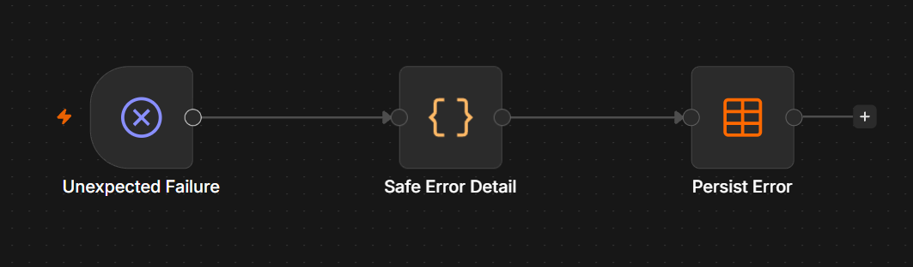
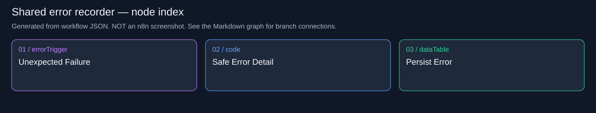
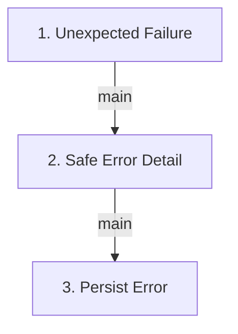

# Lead Sniper | Cloud / Record Errors

Records sanitized metadata for unexpected production errors from all four other workflows.

**Live canvas:** https://tryedwin.app.n8n.cloud/workflow/wRzekCTIYvCpuZGc

**Canvas elements:** 3 (including sticky notes and model subnodes).

## Visual reference

Actual n8n canvas screenshots supplied by the project owner. Images are included unchanged; they show canvas layout, not proof that every branch executed successfully.

### Shared error recorder: Error Trigger, sanitized metadata, and persistent error record.



[Open full-resolution screenshot](images/40-errors-canvas.png)

### Supplemental node index

The following SVG and Mermaid graph are generated from the workflow export. They provide readable node names and exact branch connections; they are diagrams, not screenshots.



## How to explain this workflow

Distinguish explicit service-error branches from unexpected workflow failure handling. This workflow logs errors; it does not notify Slack.

The detailed graph below shows branch labels and loops. Node numbers match the explanations. A model connection is shown as ai_languageModel; it supplies the chain, not an ordinary item stream.



## Every node explained

### 1. Unexpected Failure

**Node type:** `n8n-nodes-base.errorTrigger` (v1).

Error Trigger entry point for unexpected production failures from linked workflows. It is not the ordinary HTTP retry branch and does not normally fire for manual test runs.

**Receives from:** Trigger entry or disconnected annotation; no main predecessor.

**Next paths:** main → 2. Safe Error Detail


### 2. Safe Error Detail

**Node type:** `n8n-nodes-base.code` (v2).

Extracts execution ID, workflow name and last node, adds a timestamp and a generic diagnostic message. Deliberately omits raw request bodies, profile text and provider error details.

**Receives from:** 1. Unexpected Failure (main)

**Next paths:** main → 3. Persist Error

Runtime transformation (shared helper definitions omitted):


```javascript

const e=$input.first().json;return [{json:{occurred_at:new Date().toISOString(),detail:JSON.stringify({execution_id:e.execution?.id,workflow:e.workflow?.name,node:e.execution?.lastNodeExecuted||'trigger',message:'Unexpected execution failure; inspect metadata and pending leads'})}}];

```

### 3. Persist Error

**Node type:** `n8n-nodes-base.dataTable` (v1.1).

Inserts occurred_at and detail into lead_sniper_events. It does not send a Slack notification or repair the failed workflow. The error handler does not reference itself.

**Receives from:** 2. Safe Error Detail (main)

**Next paths:** No outgoing connection. This branch ends here.

Table: `lead_sniper_events`; operation: `insert`.

Saved column mappings:

- `occurred_at` ← `={{ $json.occurred_at }}`

- `detail` ← `={{ $json.detail }}`

## Demo accuracy notes

Only stars after setup are eligible for discovery. Qualification uses OR, not AND. A saved pitch is reused for delivery retries. Ambiguous Slack delivery is not automatically resent.

Live GitHub setup/scan and dummy Slack delivery passed. Real AI generation remains blocked by account credits. Do not describe dummy text as an LLM result.

The supplied screenshots are embedded above. Use their full-resolution links to zoom into the canvas; use the generated graph and node explanations when a connection or label is cropped or overlapped.
