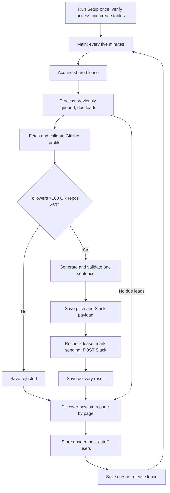

# Assignment 1 — How Lead Sniper works

Read next: [Each workflow explained](02-WORKFLOWS.md) · [Interview notes](03-INTERVIEW.md)

## Purpose

Lead Sniper monitors new stars on **Edwinzynx/hdsd-whisperFT**, fetches each user's GitHub profile, and qualifies users with **followers > 100 OR public repositories > 50**. For qualified users, it generates one sentence from their bio/company and posts an internal Slack notification.

This guide covers the five Cloud workflows in [deliverables/workflows](../../deliverables/workflows). The root `workflows/` folder is an older PostgreSQL alternative, not part of this submission.

## Complete flow

This is the normal-flow overview; individual retry and skip branches are explained in the [workflow guide](02-WORKFLOWS.md).

**Processing happens before discovery.** A user discovered during this cycle normally gets processed in a later cycle. The schedule is five minutes, not a guaranteed five-minute delivery time.

## How data moves

1. **Setup** records a fixed monitoring-start timestamp. Older stars are ignored, and rerunning Setup preserves this timestamp.
2. **Discovery** converts GitHub results into `user_id`, `login` and `starred_at`. It stores only unseen users whose star time is after the cutoff.
3. **Processing** loads the saved lead, validates the full profile, applies the numeric rule, then saves each completed stage.
4. **AI and Slack** run only for qualified profiles. The pitch and exact message payload are saved before sending so a delivery retry can reuse them.

| Data Table | Stores |
| --- | --- |
| `lead_sniper_control` | Repository, cutoff, page cursor, lease and service cooldowns |
| `lead_sniper_leads` | Unique-by-policy `repo_id:user_id` key, status, stage, attempts, profile, pitch and payload |
| `lead_sniper_events` | Sanitized unexpected-error metadata |

Nodes pass a `state` object containing control/config and, when processing, a lead. HTTP/table nodes replace their inputs with response data; named restore nodes recover the earlier state for the next step.

## Reliability rules

- A conditional **600-second lease** prevents overlapping coordinators under the intended single-writer design. Main uses a 150-second work budget within its configured 180-second timeout.
- Discovery saves new leads **before** advancing the cursor. Replayed pages check existing keys rather than resetting users.
- GitHub rate-limit responses save a shared cooldown. Counted stage failures stop after five attempts.
- Slack `200` with `ok` means delivered; `429` schedules a retry. Timeout, server error or ambiguous success becomes `delivery_unknown`, requiring manual channel verification before any resend.

## Setup and evidence

Import Main and all four supporting workflows, relink Main's child calls, select GitHub/OpenAI credentials, and enter the Slack webhook privately. Run Setup serially, assign Record Errors as the other workflows' error handler, and publish/save the required versions before enabling Main's schedule. Exports contain placeholders rather than working credentials.

All **51 existing local tests passed** during the documentation review, using mocked external services. Project records and the screenshot establish GitHub scanning and a labeled dummy Slack message; the last recorded real AI attempt lacked credits. Real AI-generated end-to-end delivery and acceptance of the repository substitution remain unestablished by that evidence.

Polling can miss stars removed between scans, and Slack delivery is not exactly once. The design has no automatic retention policy or multi-worker Cloud claims.
