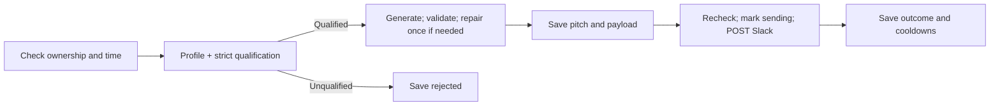

# Assignment 1 — Each workflow explained

[Entire system](01-END-TO-END.md) · [Interview notes](03-INTERVIEW.md)

## 1. Setup and Preflight

[Workflow JSON](../../deliverables/workflows/supporting-workflows/00-Setup-and-Preflight.json)

**Purpose:** verify access and initialize persistent state. **Trigger:** manual, normally run once.

- `Repository → Check Repository → Validate Repository` fetches repository metadata and checks the expected name and ID.
- `Check Stargazer Access → Require Listing Access` verifies the actual listing endpoint. It requests timestamped stars using `Accept: application/vnd.github.star+json`; metadata access alone is insufficient.
- Three `Create ... Table` nodes create control, leads and events tables if absent.
- `Find Existing Control → Validate Singleton → Needs Initialization?` rejects duplicate control rows. If none exists, `Initialize Monitoring → Insert Initial Control` saves the cutoff, first-page cursor and initial settings. If one exists, Setup preserves it.

**Input/output:** no caller input; outputs durable tables/configuration. GitHub errors stop initialization. Run serially because the Cloud design does not enforce a unique control-key constraint.

## 2. Main Coordinator

[Workflow JSON](../../deliverables/workflows/Lead-Sniper-Main.json)

**Purpose:** coordinate sequential work. **Triggers:** every five minutes or Manual Run.

- `Read Control → Prepare Lease → Lease Available?` checks configuration and lease expiry.
- `Acquire Conditional Lease` matches row ID, previous version and expired lease before setting this execution as owner. `Cycle Context` carries the owner, config and 150-second deadline.
- `Get Due Leads → Prepare Lead Jobs → Loop Leads → Process Lead` selects at most five pending, due leads and processes them one at a time. An empty queue produces a skip item so discovery still runs.
- `Prepare Page Slots → Loop Pages → Discover Page → Continue Scan?` offers up to 100 sequential page opportunities. Actual work stops earlier when time, cooldown or pagination requires it.
- `Release Lease` clears ownership only if the same execution still owns it.

**Input/output:** reads persisted state and calls children synchronously. Loop output **1** is the item path; output **0** means done. Newly discovered leads normally wait until the next cycle.

## 3. Discover One Page

[Workflow JSON](../../deliverables/workflows/supporting-workflows/20-Discover-One-Page.json)

**Purpose:** turn one GitHub page into durable new lead jobs. **Trigger:** called by Main.

- `Read Control → Prepare Page → Page Allowed?` requires ownership, at least 40 seconds remaining, and GitHub availability.
- `Pace GitHub → Fetch Stargazer Page` waits one second, then GETs the saved cursor with a 30-second timeout.
- `Classify Page / Page Network Failure` separates success, retry and permanent failure. `Normalize Page` validates user IDs, logins, timestamps and the next-page link.
- `New Stars Only` keeps timestamps strictly after the cutoff and deduplicates users within the page. `Find Existing Candidate Keys → Remove Seen Leads` removes stored `repo_id:user_id` keys using up to 100 OR filters.
- `Insert New Leads in Bulk` writes unseen users as `queued`, stage `profile`, pending true. `Advance Saved Cursor → Commit Cursor` then saves the next page or resets to page 1 on completion.
- Failed pages go through `Record Scan Failure → Save Scan Failure`, preserving the cursor and recording a cooldown or pause.

**Input/output:** receives Main's `state`; returns `{state:{more,done,status}}`. Main uses `more` to continue scanning. Existing lead keys remain seen even after rejection, failure or delivery.

## 4. Process Lead

[Workflow JSON](../../deliverables/workflows/supporting-workflows/30-Process-Lead.json)

**Purpose:** resume one lead through profile, AI and Slack stages. **Trigger:** called by Main.

| Node group | What it does |
| --- | --- |
| `Prepare Lead`, recovery/time gates | Reloads control; normally requires 115 seconds remaining. Previously interrupted `sending` work becomes unknown without reposting. |
| `Needs Profile?`, profile request/classification nodes | Fetches `/users/{encoded login}` when GitHub is available; restores request state after the HTTP response. |
| `Normalize and Filter → Save Profile → Qualified Lead?` | Requires matching user ID and nonnegative integer counts. Applies **followers >100 OR public_repos >50**; rejects `(100,50)`. Missing name falls back to login; bio/company may be null. |
| `Needs AI? → Prepare AI Prompt → Generate Pitch` | Uses bio/company and optional product context. OpenAI Model defaults to `gpt-4o-mini`, temperature 0.2, maxTokens 160, timeout 20 seconds and no automatic retries. |
| Pitch validation and `Repair Pitch Once` | Requires one nonempty sentence, terminal punctuation, no newline/HTTP link, at most 60 words and 800 characters. One invalid output gets one fresh repair; further failure defers the AI stage. |
| `Prepare Saved Pitch → Save Pitch and Payload` | Stores valid text, model/prompt version and Slack blocks before delivery. Delivery retries skip AI. |
| `Recheck Send Lease → Authorize Send → Mark Sending → Send Slack` | Requires ownership, 40 seconds remaining and no Slack cooldown. Saves sending with a due time six minutes ahead, then POSTs the stored payload. |
| Slack/GitHub/AI outcome branches | Save delivered, retry_wait, failed or delivery_unknown, followed by shared cooldowns. Restore nodes keep state available after table writes. |

**Input/output:** receives `state.lead`, its table row ID and Main's ownership context; returns a compact status. The saved stage determines which steps are skipped on retries.

The Slack message contains name/login, repository, bio/company, counts, qualification reason, AI rationale, profile link and a stable reference. Text uses plain-text blocks. The webhook URL is configured privately; it must not appear in shared exports.

## 5. Record Errors

[Workflow JSON](../../deliverables/workflows/supporting-workflows/40-Record-Errors.json)

**Purpose:** record unexpected execution failures. **Trigger:** n8n Error Trigger, assigned through the other workflows' settings.

`Unexpected Failure → Safe Error Detail → Persist Error` extracts execution ID, workflow and last node, then stores a timestamp and generic message in the events table. It omits raw provider errors and request secrets.

This workflow logs rather than retries or sends Slack alerts. Provider errors already handled by the explicit branches may not invoke it. A Data Table outage can also prevent error persistence.

## Expressions and debugging essentials

| Expression / field | Meaning |
| --- | --- |
| `$json.state.config.next_url` | Current saved page URL |
| `$('Prepare Profile').first().json.state` | Recover context after HTTP replaces the item |
| `JSON.parse(control.data)` / `JSON.stringify(lead)` | Decode/encode state stored in string columns |
| `pending` and `due_at` | Determine which rows Main selects |
| `stage` | Determines whether profile, AI or delivery resumes |

When debugging, check lease ownership, time budget, pending/due fields, service cooldowns and stage attempts before retrying. Keep visible table columns consistent with embedded JSON. For `delivery_unknown`, verify the Slack reference before authorizing another send. A successful n8n execution can still have saved a failed or deferred lead.
